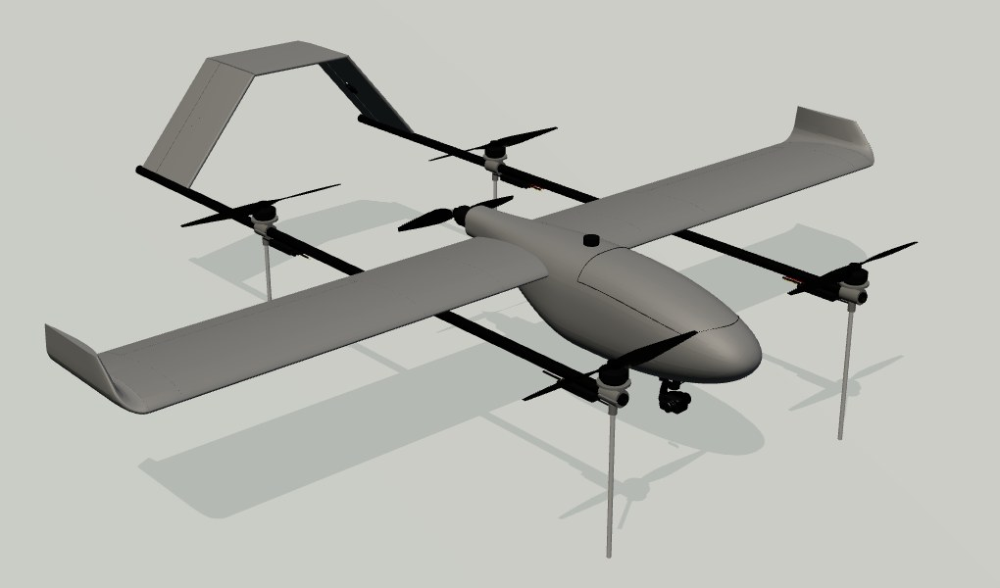

# Virmaya-33A

A hybrid VTOL quadplane for vegetation monitoring in the Sahel. It takes off and lands like a quadcopter, flies its survey like a plane, and carries a gimbal camera whose images feed **SahelSense**, the onboard vegetation indexing software.

This repository holds the aircraft's simulation (Gazebo Harmonic + ArduPilot SITL), its parameters, test tools, and the SahelSense software.



## The aircraft

| | |
|---|---|
| Layout | Quadplane: 4 lift motors on twin booms, rear pusher, ruddervator tail |
| Wingspan | 1.8 m, Clark-Y aerofoil, wing area about 0.49 m² |
| Mass (sim) | 5.5 kg take-off |
| Lift motors | QM5010 with 15x5.5 in props, Emax BLHeli 50 A ESCs |
| Pusher | T-Motor AT3520 with 12x4.5 in prop, FLAME 80 A HV ESC |
| Servos | TowerPro MG90S on ailerons and ruddervators |
| Camera | SIYI A8 mini on a 3-axis gimbal |
| Autopilot | ArduPlane (QuadPlane) |
| Companion computer | Orange Pi 5 (RK3588S NPU) running SahelSense |
| Speeds | min 15, cruise 19, max 26 m/s |

## Quick start (simulation)

You need Ubuntu 22.04 or 24.04 with Gazebo Harmonic, ArduPilot and the ardupilot_gazebo plugin. [docs/setup.md](docs/setup.md) covers all of it from a fresh machine.

```bash
git clone https://github.com/mk-bardi/virmaya-33a.git ~/virmaya-33a
cd ~/virmaya-33a
./install.sh
source ~/.bashrc

virmaya                 # fly at the flat test field (Zaria)
virmaya baylands        # fly in the Baylands park
virmaya-showroom        # look at the aircraft up close
simstop                 # close everything
```

`virmaya` opens Gazebo, SITL with MAVProxy and a map, and a live dashboard. Fly a survey from the MAVProxy window:

```
wp load ~/virmaya-33a/missions/runway_survey.waypoints
wp set 1
rc 3 1000
mode auto
arm throttle
```

More in [docs/flying.md](docs/flying.md).

## What is in the repo

| Folder | What it holds |
|---|---|
| `models/virmaya/` | The Gazebo model: mass and inertia from a part-by-part budget, lift-drag aerodynamics, motors, control surfaces, gimbal camera |
| `params/virmaya.parm` | ArduPilot parameters for SITL |
| `worlds/` | `runway` (flat field, Zaria), `baylands` (park, downloaded from Gazebo Fuel on first use), `showroom` |
| `missions/` | Example VTOL survey missions for each world |
| `tools/` | Launcher, live dashboard, log extractor, and a world builder that makes Gazebo worlds from satellite imagery and terrain |
| `sahelsense/` | The SahelSense vegetation indexing software |
| `docs/` | Setup, flying, troubleshooting |

## How close is the sim to the real aircraft

Geometry and hardware layout come from the CAD. These are still estimates:

- Mass and inertia come from a part-by-part budget, not from weighing.
- Lift thrust (about 26 N per motor) and pusher thrust (about 30 N) are datasheet estimates.
- Hover throttle in the params is 0.5. Replace it with the value the real aircraft learns (`Q_M_THST_HOVER`).
- The SITL battery is a placeholder, so endurance numbers from the sim are not real yet.

## License

MIT, see [LICENSE](LICENSE).

Built by Muhammad Mukhtar Bardi ([@mk-bardi](https://github.com/mk-bardi)), Mechatronics Engineering, Ahmadu Bello University, Zaria.
