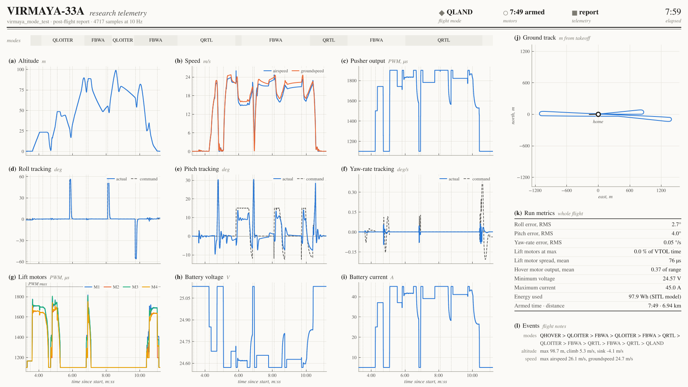

# Flying the sim

## Start and stop

```bash
virmaya                         # flat test field near Zaria
virmaya baylands                # Baylands park (first launch downloads it, a few minutes)
virmaya runway --name hover_01  # label the dashboard results
virmaya runway --no-dash        # without the dashboard
virmaya --wipe                  # clear SITL's saved parameters (first run, or after editing virmaya.parm)
simstop
```

Four windows open: Gazebo, the SITL/MAVProxy console (type commands here), the map and the dashboard.

After `--wipe`, SITL asks for an accelerometer calibration. Type `accelcalsimple` once in the MAVProxy window.

## Camera

```bash
chase            # follow from 8 m behind, 2.5 m up
chase 5 1.5      # closer
chase off        # free look
```

## Quick hover test

In MAVProxy:

```
mode qhover
arm throttle
rc 3 1700        # climb
rc 3 1500        # hold height
mode qland
```

## Missions

| File | World | What it flies |
|---|---|---|
| `missions/runway_survey.waypoints` | runway | VTOL takeoff to 40 m, five 600 m survey lines at 80 m, VTOL landing at home |
| `missions/baylands_survey.waypoints` | baylands | Long survey over the park at 200 m, VTOL landing at home |

```
wp load ~/virmaya-33a/missions/runway_survey.waypoints
wp list          # check the coordinates match the world you are in
wp set 1
rc 3 1000
mode auto
arm throttle
```

The first mission item must be a VTOL takeoff (command 84). A mission made for one place does nothing useful in another world.

To plan your own, connect Mission Planner or QGroundControl to SITL at `tcp:127.0.0.1:5763`, then save the `.waypoints` file into `missions/`.

## Results

The dashboard is built for research. Panels (a) to (i) are figure-style plots on a shared time axis: altitude, speed, pusher output, roll, pitch and yaw-rate tracking (actual against the autopilot's command, grey dashed), lift-motor outputs against PWM max, battery voltage and current. A timeline under the header shows the flight mode at every moment. Panel (k) gives run metrics, over the last 90 s while flying and over the whole flight in the report:

| Metric | What it tells you |
|---|---|
| Roll and pitch error, RMS | How well the attitude follows the command |
| Yaw-rate error, RMS | Needs `--pid` (the launcher sets it) |
| Lift motors at max | Share of VTOL time with any lift motor within 20 µs of PWM max. Above a few percent, the aircraft is short of thrust or yaw authority |
| Lift motor spread | Mean gap between the highest and lowest lift motor. A large spread means the motors are fighting an imbalance (CG, yaw, a weak motor) |
| Hover motor output | Mean lift-motor output while hovering, as a fraction of the PWM range |
| Voltage, current, energy | Power figures. Energy is from the SITL battery model, which is not calibrated yet |

When the dashboard closes it saves to `~/sim_results/`:

- `<date>_<time>_<name>.csv`: every sample at 10 Hz,
- `<date>_<time>_<name>.png`: the report,
- `<date>_<time>_<name>.pdf`: the same report as a vector file, for papers and the thesis,
- `<date>_<time>_<name>_summary.txt`: a text summary with the research metrics.



Rebuild a report from a CSV with `python3 tools/sim_dashboard.py --report <file.csv> --title VIRMAYA-33A`. To keep one in the repo, copy it under `results/` and `git add -f` it.

## Logs

SITL writes `.BIN` logs under `~/logs/`. Pull the useful message types into CSVs:

```bash
python3 tools/extract_log.py ~/logs/00000012.BIN ~/sim_results/log12
```

The same script works on logs from the real aircraft, which is how sim and real flights should be compared.

## New worlds

`tools/make_sim_world.py` builds a world from satellite imagery and terrain (Mapbox, Esri, or your own GeoTIFFs). Run it with `--help` for the options. Worlds go to `~/sim_worlds/<name>/`; fly there with `virmaya <name>`.
